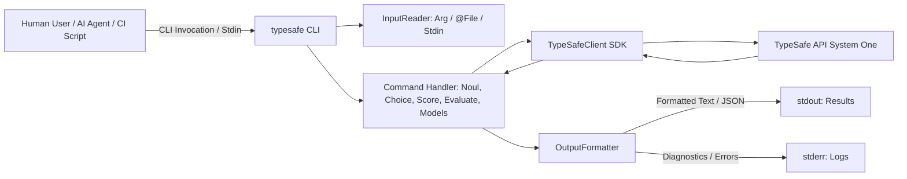

# Requirements

### Overview & Goals
Maximize workflow utility and developer velocity by introducing a native **TypeSafe CLI** (`TypeSafe.Cli`, packaged as the `typesafe` global tool). While the TypeSafe MCP server caters to interactive LLM agent environments via JSON-RPC, human developers, automated CI/CD pipelines, and command-line AI agents (e.g., shell-based agents, scripts, and terminal runners) require a high-throughput, low-friction CLI tool.

The CLI bridges this gap by exposing TypeSafe System One evaluation primitives (`noul`, `choice`, `score`, `evaluate`) and model inspection (`models`) directly to the command line, supporting POSIX composability (stdin/stdout streaming, file argument resolution, and structured JSON output).

### Scope
**In Scope:**
- New project `src/TypeSafe.Cli` targeting `net11.0`, AOT-ready, packaged as a .NET global tool (`ToolCommandName=typesafe`).
- Commands: `noul`, `choice`, `score`, `evaluate`, `models`.
- Input flexibility: inline arguments, `@path/to/file` references, or stdin streaming (`-` or piped input).
- Dual output modes: human-friendly styled terminal output (percentages, confidence indicators, legends) and agent/script-oriented machine-readable output (`--json`).
- Configuration hierarchy: CLI switches → Environment variables (`TYPESAFE_API_KEY`, `TYPESAFE_BASE_URL`, `TYPESAFE_DEFAULT_MODEL`) → Defaults.
- Test suite in `tests/TypeSafe.Cli.Tests` and inclusion in `TypeSafe.slnx`.
- Documentation in repository `README.md` and project `README.md`.

**Out of Scope:**
- Interactive TUI or persistent background daemons.
- Direct mutations to `TypeSafe` SDK core package API.
- Binary distribution via non-.NET package managers (e.g. Homebrew/Apt), though .NET tool and published single-file executables are enabled.

### User Stories
- **As a developer in a terminal**, I want to quickly test a prompt or classification hypothesis (`typesafe choice "Error 500 in auth" "Classify" -c auth="Auth" -c db="DB"`) without writing boilerplate code or launching an IDE.
- **As an AI agent with shell execution access**, I want to run `typesafe noul --json "..." "Is this code safe?"` and parse the raw JSON from stdout with zero protocol overhead.
- **As a DevOps engineer in CI/CD**, I want to pipe pull request diffs or logs into `typesafe score - "Rate release risk" -l low -l medium -l high` and inspect the exit code or JSON output to gate automated deployments.

### Functional Requirements
- **Command structure:**
  - `typesafe noul <state> <instructions> [--true <criteria>] [--false <criteria>] [--model <model>] [--json]`
  - `typesafe choice <state> <instructions> -c/--choice <label=description>... [--model <model>] [--json]`
  - `typesafe score <state> <instructions> -l/--level <description>... [--model <model>] [--json]`
  - `typesafe evaluate <state> [--file <questions.json> | --questions <json>] [--model <model>] [--json]`
  - `typesafe models [--json]`
- **State resolution:**
  - Positional argument string (plain text or JSON object/array).
  - `@<filepath>` syntax to read file contents directly.
  - Stdin (`-` or omitted positional state when piped standard input is detected).
- **Output formatting:**
  - Default (Human mode): concise, formatted text summary displaying the winning prediction, probability/confidence percentages, token usage, and latency.
  - Machine mode (`--json`): compact or formatted JSON matching the evaluation model contract, output strictly to stdout.
  - Stderr routing: all progress logs, diagnostics, and errors write exclusively to stderr to guarantee that stdout remains cleanly parseable by pipes and JSON parsers (`jq`).
- **Exit codes:**
  - `0`: Evaluation succeeded.
  - `1`: TypeSafe API error, authentication failure, or network error.
  - `2`: Invalid command syntax, missing arguments, or invalid option values.

### Non-Functional Requirements
- **Performance & Latency:** Zero unnecessary allocations; fast startup matching Native AOT compatibility (`PublishAot=true`, `InvariantGlobalization=true`).
- **Composability:** Strict adherence to UNIX philosophy (clean stdout stream separation from stderr diagnostic stream).
- **Security:** API keys redacted from terminal logs; zero credential leakage in error messages.

# Technical Design

### Current Implementation
- `src/TypeSafe`: Core SDK client (`TypeSafeClient`), request/response data models (`SystemOneRequest`, `Questions`, `SystemOneResult`, `ModelCard`), and resilient HTTP handler.
- `src/TypeSafe.Mcp`: MCP server wrapping the client for MCP-compliant hosts (Claude Desktop, Rider, VS Code). Contains reusable patterns for `StateParser`, `QuestionFactory`, and result mapping.
- `TypeSafe.slnx`: Unified solution containing SDK, MCP server, sample application, and test suites.

### Key Decisions
1. **`System.CommandLine` for CLI parsing:**
   - *Rationale:* Standard Microsoft command-line parsing library designed for .NET, fully compatible with Native AOT and trimming, offering robust POSIX compliance, built-in help generation, and custom token parsing for `--choice key=value` pairs.
2. **Unified Input Handling (`InputReader`):**
   - *Rationale:* Maximizes utility across scripting and interactive environments by seamlessly resolving whether state is provided as a direct string, file path `@file.txt`, or standard input stream (`Console.IsInputRedirected`).
3. **Clean Output Separation (`OutputFormatter`):**
   - *Rationale:* AI agents and automation scripts require deterministic JSON on stdout, whereas human operators benefit from colored, percentage-formatted summaries. Diagnostic logs always route to stderr.
4. **Direct Dependency on `TypeSafe` SDK:**
   - *Rationale:* Maintains low footprint and reuses the SDK's battle-tested exponential backoff, jitter, retry policies, and credential protection without intermediate layers.

### Proposed Changes
- **`src/TypeSafe.Cli/TypeSafe.Cli.csproj`:**
  - Global tool executable project targeting `net11.0`.
  - Configured with `PackAsTool=true`, `ToolCommandName=typesafe`, `PublishAot=true`.
  - References `src/TypeSafe/TypeSafe.csproj` and `System.CommandLine`.
- **`src/TypeSafe.Cli/Program.cs`:**
  - Root command definition with global options (`--api-key`, `--base-url`, `--model`, `--json`, `--verbose`).
  - Subcommands: `noul`, `choice`, `score`, `evaluate`, `models`.
- **`src/TypeSafe.Cli/InputReader.cs`:**
  - Asynchronously reads state payload from argument, `@file`, or piped stdin (`Console.In`).
  - Implements lightweight JSON sniffing to pass parsed JSON objects when applicable.
- **`src/TypeSafe.Cli/OutputFormatter.cs`:**
  - Renders `EvaluationResult` as human-readable formatted text or serialized JSON depending on the `--json` flag.
- **`src/TypeSafe.Cli/Commands/*`:**
  - Isolated command handlers for `NoulCommand`, `ChoiceCommand`, `ScoreCommand`, `EvaluateCommand`, and `ModelsCommand`.
- **`tests/TypeSafe.Cli.Tests`:**
  - Automated tests verifying parsing of options, stdin handling, output formatting, exit codes, and mock HTTP interactions.

### Data Models / Contracts
```csharp
namespace TypeSafe.Cli;

public sealed record CliGlobalOptions(
    string? ApiKey,
    Uri? BaseUrl,
    string? Model,
    bool Json,
    bool Verbose);

public static class InputReader
{
    public static async Task<string> ReadStateAsync(string? stateArgument, CancellationToken cancellationToken = default);
}

public static class OutputFormatter
{
    public static void WriteEvaluation(EvaluationResult result, bool jsonOutput);
    public static void WriteModels(IReadOnlyList<ModelCard> models, bool jsonOutput);
    public static void WriteError(string message, bool jsonOutput);
}
```

### File Structure
```
src/
  TypeSafe.Cli/
    Commands/
      ChoiceCommand.cs
      EvaluateCommand.cs
      ModelsCommand.cs
      NoulCommand.cs
      ScoreCommand.cs
    Formatting/
      OutputFormatter.cs
    IO/
      InputReader.cs
      StateParser.cs
    Program.cs
    TypeSafe.Cli.csproj
    TypeSafeCliJsonSerializerContext.cs
    README.md
tests/
  TypeSafe.Cli.Tests/
    CliTestHarness.cs
    CommandsTests.cs
    InputReaderTests.cs
    OutputFormatterTests.cs
    TypeSafe.Cli.Tests.csproj
```

### Architecture Diagram


### Risks
- **Stdin blocking in interactive sessions:** If a user invokes `typesafe noul` without arguments in an interactive terminal, waiting indefinitely on stdin would degrade user experience.
  - *Mitigation:* Inspect `Console.IsInputRedirected`; if false and argument is missing, display command help / error immediately rather than hanging.
- **AOT / Trimming reflection issues:** CLI argument binders and JSON serialization may fail in Native AOT mode if reflection is used.
  - *Mitigation:* Use source-generated `JsonSerializerContext` (`TypeSafeCliJsonSerializerContext`) and AOT-safe command configurations.

# Testing

### Validation Approach
Automated verification will ensure functional accuracy, edge case resilience, exit code conformance, and seamless interoperability with both human shell pipelines and AI agent consumers.

### Key Scenarios
1. **Noul Evaluation:**
   - Run `typesafe noul "statement" "instructions"`.
   - Verify correct probability output, usage token reporting, and exit code `0`.
2. **Choice Evaluation:**
   - Run `typesafe choice "state" "instructions" -c label1="desc1" -c label2="desc2"`.
   - Verify classification selection, label probabilities dictionary, and confidence metrics.
3. **Score Evaluation:**
   - Run `typesafe score "state" "instructions" -l low -l medium -l high`.
   - Verify numerical score, confidence, and mapped legend tiers.
4. **Multi-Question Evaluation:**
   - Run `typesafe evaluate "state" --file questions.json`.
   - Verify parallel question execution and aggregate result formatting.
5. **Stdin & File Piping:**
   - Pipe input via `echo 'text' | typesafe noul - "Is this valid?"`.
   - Pass file reference via `@sample.json`.
   - Verify proper payload extraction and payload transmission.
6. **JSON Output Interoperability:**
   - Run commands with `--json`.
   - Assert that stdout contains strictly valid, parseable JSON and stderr contains any diagnostic logs.

### Edge Cases
- Missing API key when no environment variable is set (verify readable stderr message and exit code `1`).
- Invalid rubric count (< 2 levels for score command; verify exit code `2` with descriptive error).
- Stdin piping with empty input stream (verify graceful validation failure).
- Rate limits and HTTP error status codes (verify request ID inclusion and proper exit code `1`).

### Test Changes
- Create `tests/TypeSafe.Cli.Tests/TypeSafe.Cli.Tests.csproj` referencing xUnit and `TypeSafe.Cli`.
- Implement `CliTestHarness` with redirected standard I/O streams and stub HTTP message handlers.
- Add comprehensive test classes: `CommandsTests.cs`, `InputReaderTests.cs`, and `OutputFormatterTests.cs`.

# Delivery Steps

### ✓ Step 1: Scaffold TypeSafe.Cli project and core execution pipeline
The core CLI project structure and argument routing are established with global configuration options.

- Create `src/TypeSafe.Cli/TypeSafe.Cli.csproj` configured for `net11.0`, C# 15, `PackAsTool=true`, `ToolCommandName=typesafe`, and `PublishAot=true`.
- Add `src/TypeSafe.Cli/TypeSafe.Cli.csproj` and `tests/TypeSafe.Cli.Tests/TypeSafe.Cli.Tests.csproj` to `TypeSafe.slnx`.
- Implement `CliOptions` and `RootCommandBuilder` handling global flags (`--api-key`, `--base-url`, `--model`, `--json`, `--verbose`).
- Implement `InputReader` supporting positional text, `@filepath` syntax, and standard input streaming (piped input / `-`).
- Implement `OutputFormatter` managing dual output modes: human-friendly formatted terminal output vs. raw structured JSON output for AI agents and scripts.
- Add initial test harness in `tests/TypeSafe.Cli.Tests/CliTestHarness.cs` validating root parsing, environment variable resolution, and exit code handling.

### ✓ Step 2: Implement evaluation subcommands and model listing
The CLI provides specialized subcommands for Noul, Choice, Score, and general evaluation along with model listing.

- Implement `NoulCommand` (`typesafe noul <state> <instructions> [--true <criteria>] [--false <criteria>] [--model <model>] [--json]`).
- Implement `ChoiceCommand` (`typesafe choice <state> <instructions> --choice <label=desc>... [--model <model>] [--json]`).
- Implement `ScoreCommand` (`typesafe score <state> <instructions> --level <level>... [--model <model>] [--json]`).
- Implement `EvaluateCommand` (`typesafe evaluate <state> [--file <path> | --questions <json>] [--model <model>] [--json]`) for multi-question batched evaluations.
- Implement `ModelsCommand` (`typesafe models [--json]`) listing available models from `TypeSafeClient.ModelsAsync`.
- Wire SDK exception handling (`TypeSafeError`, `ApiError`, `AuthenticationError`) into stderr reporting and standard exit codes (0 for success, 1 for runtime/API error, 2 for validation/syntax error).

### ✓ Step 3: Add CLI test coverage, pipeline integration, and documentation
Comprehensive automated test suites and end-to-end documentation ensure reliability across AI agent and human terminal workflows.

- Add unit and integration tests in `tests/TypeSafe.Cli.Tests/CommandsTests.cs` covering all subcommands with mocked HTTP responses.
- Add tests for stdin streaming, file resolution (`@file.txt`), invalid inputs, and JSON output schema consistency.
- Update `README.md` with CLI installation instructions (`dotnet tool install -g TypeSafe.Cli`), global options, piping examples (`cat ticket.json | typesafe choice - "Classify intent"`), and agent tool execution guidelines.
- Add `src/TypeSafe.Cli/README.md` for package documentation and tool discoverability.